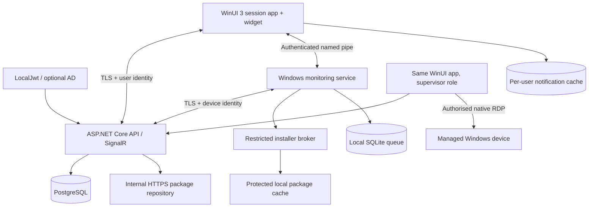

# System architecture

## Logical topology



All arrows are logical communication, not firewall rules. LAN provides transport for P1–P7; approved tailnet transport is deferred to P8. API is the authority; database and package storage remain server-side. No workstation DB credentials. The current PostgreSQL host is not on Tailscale; the later remote API endpoint may join the tailnet while PostgreSQL stays on the LAN.

## Process and trust boundaries

| Component | Runtime and responsibility |
|---|---|
| Hive.App | Unelevated per interactive session; native UI, toast activation, widget, LocalJwt-authenticated actions |
| Hive.Agent | Windows Service, least privilege, machine telemetry, inventory, durable sync, local protection state |
| Hive.Installer | Narrow privileged broker; verifies signed manifest and local safety permit, executes predefined install profiles |
| Hive.Server | ASP.NET Core HTTP API and SignalR; auth, policies, event dispatch and package streaming |
| Hive.Worker | Durable outbox dispatch, expiry, compliance recalculation and retention; may initially be hosted in server |
| PostgreSQL | Authoritative records, transaction/outbox, audit; internal-only |
| Package storage | Immutable versioned artifacts on controlled filesystem or private object store; API-mediated access |
| SQLite | Bounded machine queue and separate ACL-protected per-user cache; never store passwords |

Installer broker cannot accept arbitrary commands; generic agent compromise should not automatically grant fleet-wide publishing. Windows services operate in session 0; launch GUI through managed per-user logon registration rather than interactive service.

## Technology choices

C#/.NET 10 LTS; Windows App SDK stable compatible release; CommunityToolkit.Mvvm; ASP.NET Core; Npgsql; SQLite; SignalR; Windows native performance APIs and targeted WMI/CIM; native Win32 interop; Velopack for eligible user app updates; signed managed MSI or enterprise deployment for Windows service/broker. Server-side services (`Hive.Server`, `Hive.Worker`) are built as cross-platform `.NET 10` non-root Linux containers (`mcr.microsoft.com/dotnet/aspnet:10.0`) packaged for **Docker Stack** (`docker stack deploy` / `docker compose`), while endpoint components (`Hive.App`, `Hive.Agent`, `Hive.Installer`) remain native Windows binaries. Pin SDK/runtime, container base image digests and packages, generate SBOM, record dependency licenses and verify offline installer/image availability. No Rust required initially. Avoid Redis/broker unless measured load or multi-instance requirements justify it.

## Deployment profiles

LAN only: standalone on-prem Linux server host running the `deploy/docker/` Docker Stack against the existing LAN PostgreSQL server, with **self-contained Local Hive Accounts (`LocalJwt`)** for interactive users (zero AD domain join or IT keytab required; optional `Negotiate` Kerberos/LDAPS later) and internal PKI TLS/mTLS termination directly on Kestrel inside the stack. Hybrid (P8 only, after LAN acceptance): same topology with restricted tailnet routes or interfaces on the Linux API host (while PostgreSQL stays on the LAN) and HTTPS software downloads. Isolated: separate instance, no external coordination, local package transfer and approval. Do not bridge isolated evidence networks to hybrid network. Proxying Negotiate or client-certificate mTLS requires explicit authentication architecture and testing, not a generic HTTP reverse proxy assumption; terminate TLS/mTLS directly in `Hive.Server` unless an explicitly verified passthrough/delegation architecture is approved.

## Failure handling

Persist state transitions before publishing; notify by SignalR hints, fetch authoritative snapshots/deltas. At least once transport, idempotent effects. Database outage blocks new approvals and privileged operations. Agent preserves bounded queues and last known policy but does not start an install without fresh authorised lease and safety evaluation. Expired enrollment/certificates fail closed. API and agent versions negotiate capabilities and compatible contracts. Backups include DB, manifests, artifacts and trust configuration; private signing keys protected separately.

## Proposed repository

```
src/Hive.App/              # WinUI, notification UI
src/Hive.Agent/            # Windows service
src/Hive.Installer/        # restricted elevated broker
src/Hive.Server/           # API, hub, worker
src/Hive.Domain/           # policy, state machines
src/Hive.Contracts/        # DTOs and protocol versions
src/Hive.Infrastructure/   # persistence
src/Hive.Windows/          # telemetry, inventory, RDP, Win32
src/Cordon.Shared.Windows/    # reusable widget primitives
src/Hive.Notifications/    # durable state and routing
 tests/                        # unit/integration/Windows/UI/security
 docs/                         # this stack
 deploy/docker/                # Linux container Dockerfile, Docker Stack YAML, env template
 scripts/                      # local CI, packaging, provisioning
```

Keep platform-independent domain tests separate from Windows-specific integration tests. Local CI initially; no assumption that hosted runners can access forensic infrastructure.

## Expansion boundaries
Extend existing domain/contracts/repositories and Windows collectors, not separate microservices by default. See [Expansion contracts](EXPANSION_CONTRACTS.md). Wake relay is an explicitly authorised outbound-sync agent capability, not an inbound listener. Signed component updater is a narrowly scoped separate lifecycle process; no general execution channel.

## Authority and resilience decision
Single logical PostgreSQL authority, endpoint SQLite queues and per-user protected caches; no peer database synchronisation. See [Resilience and peer assistance](RESILIENCE_AND_PEER_ASSIST.md). The LAN baseline remains one primary/API; optional site cache/peer package transport and infrastructure HA require distinct gates. Any future cache listener is a restricted data-only process, never an inbound agent management channel.
