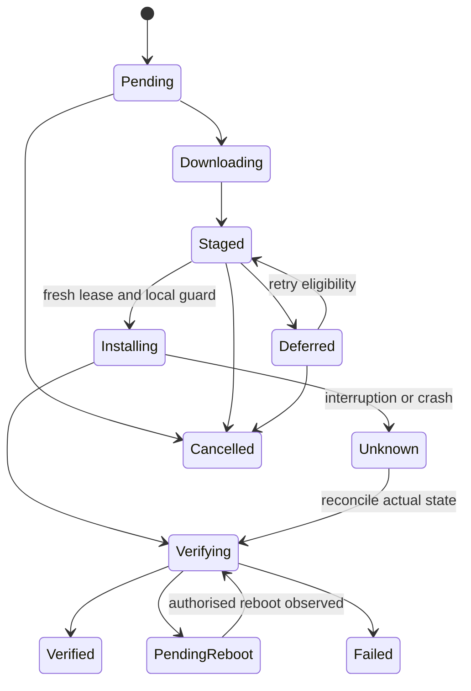

# Controlled software compliance and deployment

## Catalogue workflow

Administrator selects product or creates detection rules, release version and applicability. Record vendor release separately from laboratory approved target. Upload installer through authorised API or import server-readable path from controlled SMB staging share (not arbitrary UNC/HTTP fetch). Server copies into quarantine, computes SHA-256 and size, checks Authenticode where available, records publisher/certificate and validation reference. Independent approver reviews detection rules, tested install/uninstall behaviour, signer, dependencies, reboot and protection profiles. Publish an immutable signed manifest; changes create new release/revision and require approval again.

## Manifest contract (illustrative)

```json
{
  "schemaVersion": 1,
  "releaseId": "example-release-uuid",
  "productId": "example-tool",
  "approvedVersion": "2.5.0",
  "packageId": "example-package-uuid",
  "sha256": "<64 lowercase hexadecimal characters>",
  "sizeBytes": 123456,
  "installerType": "msi",
  "installProfileId": "validated-msi-no-restart",
  "detectionRuleRevision": 4,
  "protectedProfileRevision": 2,
  "validationReference": "VAL-EXAMPLE",
  "rebootPolicy": "never-automatic",
  "signingKeyId": "release-key-01"
}
```

Sign a canonical representation with detached signature and managed key rotation. Manifest includes all security-relevant metadata in real implementation, including product dependencies, approved invocation profile digest, applicability and immutable artifact digest. Example placeholders are not executable configuration. Installer arguments are vetted structured profiles, not free-form commands delivered from untrusted users. Support MSI first, then validated EXE/MSIX and portable packages. Vendor-specific installers may lack safe silent options; notify/manual only if unverified. No arbitrary scripts or shell execution in MVP.

## Storage and delivery

PostgreSQL stores metadata only. Artifact store uses content-addressed or immutable version paths, controlled server filesystem initially. Optional SMB intake behind server. Endpoint download via HTTPS authenticated to approved device; Range and ETag support; no SMB access or database credentials needed from endpoints. Server restricts size/type and paths, rejects symlinks/reparse traversal and incomplete uploads, quarantines unapproved content. Agent downloads to ACL-protected staging file, resumes only matching immutable ETag, verifies complete bytes and signature, promotes atomically. Broker re-verifies immediately before launching. Free space and bandwidth policy apply. Do not use evidence volumes for cache.

## Compliance and policies

Detection supports exact approved version, explicitly permitted sets or vendor-specific minimum where suitable. Older, ahead, missing, unapproved, withdrawn, exempt and unknown distinct. Scoped exemptions require reason, approver, expiry and audit; expiry triggers reassessment, not immediate unsafe update.

Policies: notify only; user initiated; mandatory when safe; scheduled maintenance. Mandatory means unresolved obligation, not permission to kill processes. Pilot ring then gradual rollout; per-site concurrency and bandwidth caps. Separate approval from deployment targeting. Preview target snapshot, version, exceptions and disk requirements. Pause rollout on failures. Cancel not-started jobs; running installers cannot be blindly terminated.

## Execution state machine



A failure may occur during any stage; keep explicit failed/unknown reason and audit. Before install: validate current approved release, fresh target-specific lease, signature, local package digest, free space, OS compatibility, license/requirements, all protected apps/services/sessions, file locks (Restart Manager discovery only), protection locks, user consent/window where required. Acquire maintenance mutex, immediately recheck, launch vetted installer without shell under broker. Configure/test installer to suppress restarts and app closure; never rely on switches without validation. Unknown workload or race risk means defer/manual. Capture exit code and sanitised installer log, detect version independently, check health and reboot requirement. Success is observed approved state, not exit code alone. Never reboot automatically in MVP. Agent journal records before start; crash recovery checks installer and actual state, never retries blindly. Rollback is an independently validated deployment with approval, not an assumed ability to undo all installs.

## Audit evidence

Record release digest, signer, package hash, validation reference, approvers, target, requested policy, safety decision/reason codes, times, attempt and detection result. Retain deployment evidence under lab policy. No passwords, case paths or confidential installer output in logs. A release may be withdrawn; revoke new leases immediately, cancel pending jobs, investigate any in-progress attempts rather than forcibly stop.
